# capstone-client

The client half of a two-container DevOps capstone. The client container connects to the server container (repository `capstone-server`) on a second AWS EC2 VM, downloads a file with its checksum, saves it to a volume and verifies the checksum. Both VMs are created with Terraform, monitored with Prometheus and Grafana, and deployed by GitHub Actions through self-hosted runners.

## Prerequisites

- Git
- Docker and Docker Compose
- Terraform and AWS CLI (configured for an IAM user, region `ap-southeast-2`)
- A Docker Hub account with a repository named `capstone-client` and an access token with Read and Write permission
- A Slack incoming webhook
- A running `capstone-server` deployment that the client can reach on port 5000
- An SSH key pair (the public key is referenced by Terraform)

## Install and configuration

Run the client locally against a server:

```
git clone https://github.com/SyedShah3994/capstone-client.git
cd capstone-client
cp .env.example .env
docker compose up --build --exit-code-from client
```

Set `SERVER_HOST` in `.env` to the address of the server. Set `SERVER_PORT` if the server does not use port 5000, for example `5001` on a Windows laptop where port 5000 is blocked. Downloaded files are stored in the named volume `clientvol`, mounted at `/clientdata`.

Create the VM with Terraform:

```
cd terraform
terraform init
terraform apply
```

Create `terraform/terraform.tfvars` yourself and keep it out of Git. It holds your own values, including the IP address allowed to use SSH. The VM is a `t3.micro` in `ap-southeast-2` inside the client subnet `10.0.2.0/24`. The security group allows SSH only from your IP and Grafana on port 3020.

Start monitoring on the VM:

```
cd monitoring
cp .env.example .env
docker compose up -d
```

Set `GRAFANA_PASSWORD` in `monitoring/.env`. Prometheus, node-exporter, cAdvisor and Grafana start together. Grafana is on port 3020 and Prometheus scrapes the three targets prometheus, node and cadvisor. The Node Exporter Full dashboard (ID 1860) is imported in Grafana.

## CI/CD

The workflow `.github/workflows/ci-cd.yml` runs on every push to `main`. Add these repository secrets first: `DOCKERHUB_USERNAME`, `DOCKERHUB_TOKEN`, `SLACK_WEBHOOK_URL` and `SERVER_PRIVATE_IP` (the private address of the server VM).

1. `build-and-push` builds the image on a GitHub-hosted runner and pushes `syedshah3994/capstone-client` to Docker Hub with the commit SHA tag and `latest`.
2. `deploy` runs on a self-hosted runner on the client VM with the label `client-vm`. It sets the commit tag in `docker-compose.yml`, writes `.env` with `SERVER_HOST` taken from `SERVER_PRIVATE_IP`, pulls the image, runs `docker compose up --exit-code-from client` and posts the result to Slack.

Register the runner on the VM as user `ubuntu`, then install it as a service so that it survives SSH disconnects:

```
sudo ./svc.sh install ubuntu
sudo ./svc.sh start
```

Deploy the server pipeline first and the client pipeline second.

## Usage

After a push to `main`, open the Actions tab and wait for both jobs to turn green. The client container fetches the file from the server at its private address and exits with code 0. The log ends with:

```
[client] CHECKSUM OK - file is intact
```

Show the result on the client VM:

```
docker ps -a
docker logs capstone-client
```

## Evidence

Both EC2 instances:

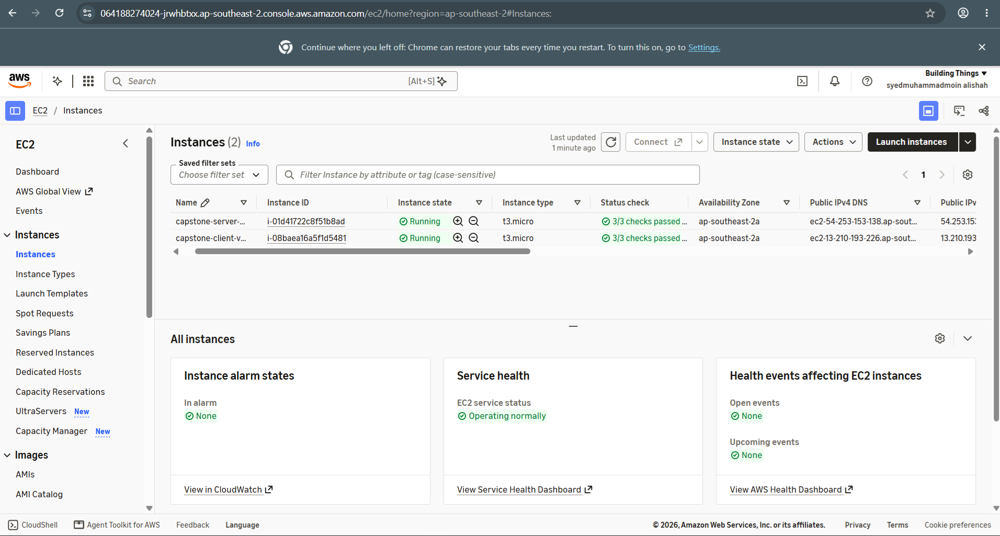

Grafana host dashboard on the server VM:

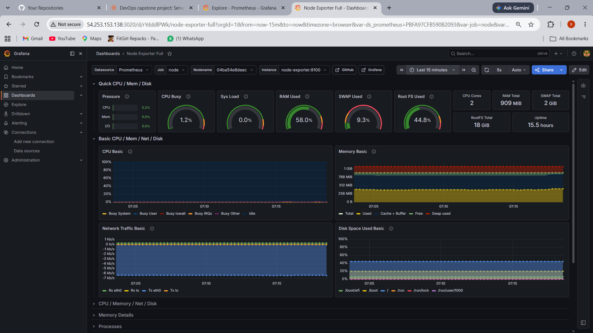

Prometheus targets on the server VM:

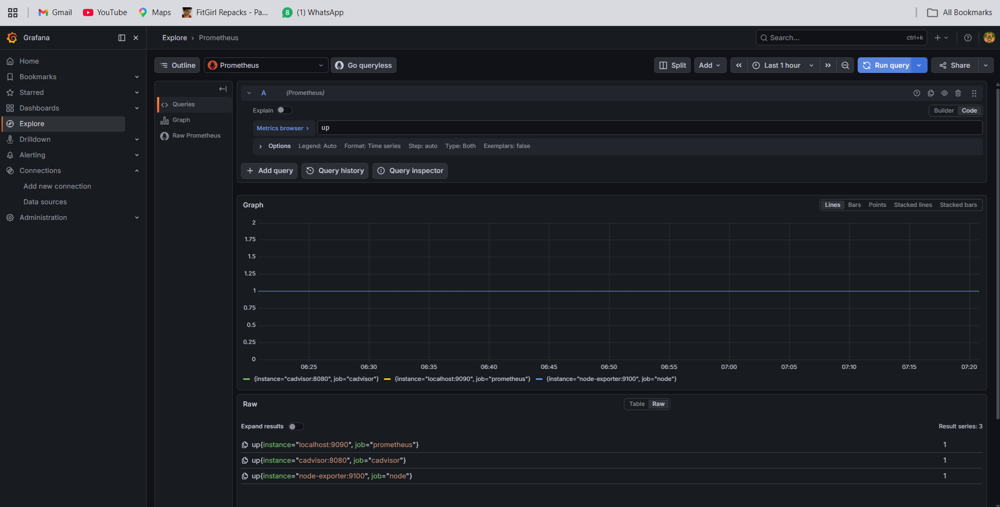

Grafana host dashboard on the client VM:

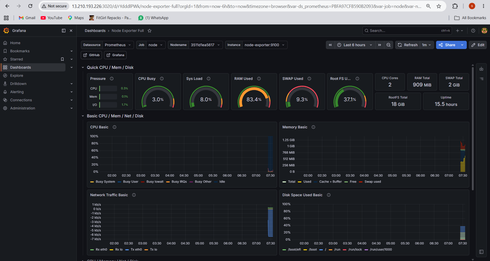

Prometheus targets on the client VM:

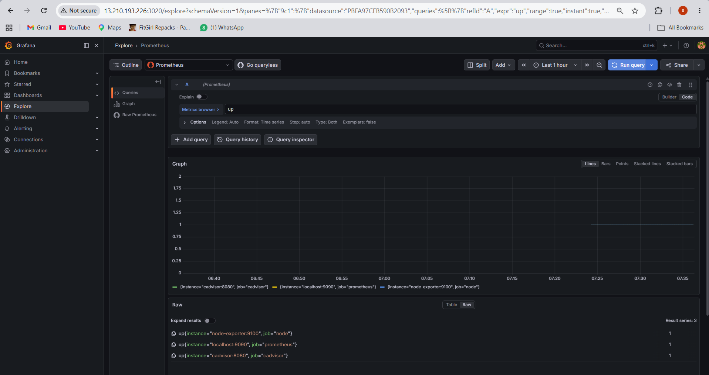

Server pipeline, both jobs green:

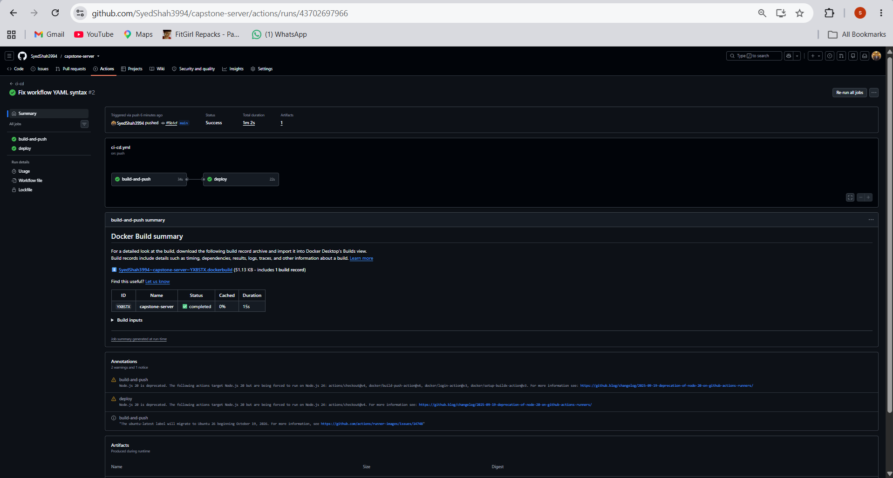

Server image tags on Docker Hub:

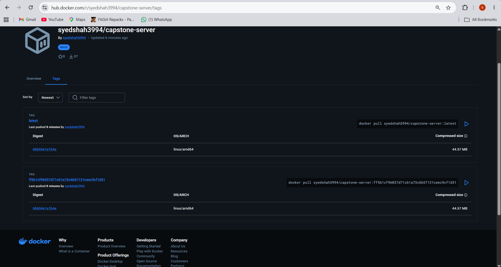

Server Slack notification:

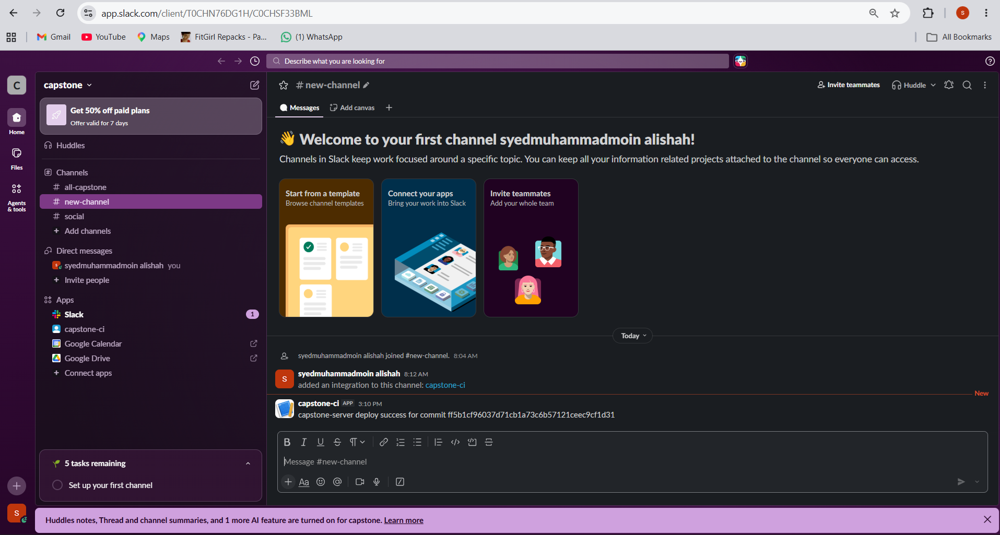

Client pipeline, both jobs green:

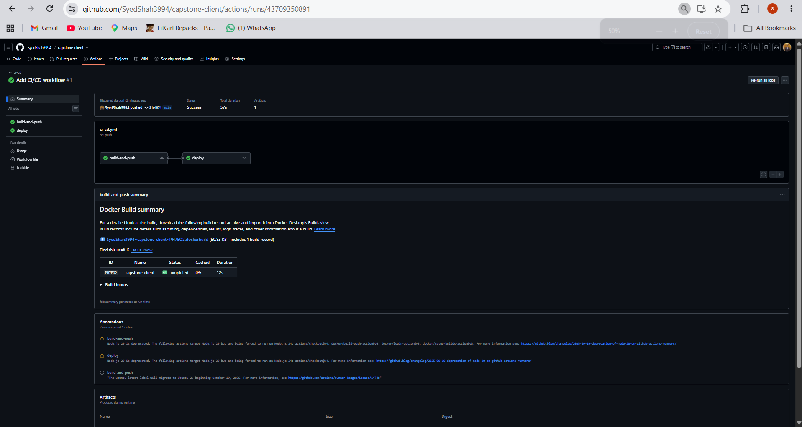

Client image tags on Docker Hub:

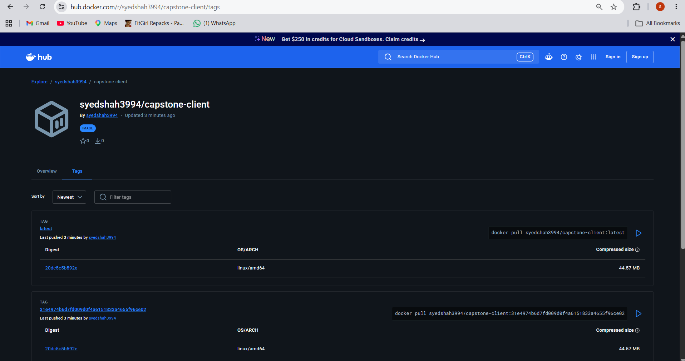

Slack notifications for both pipelines:

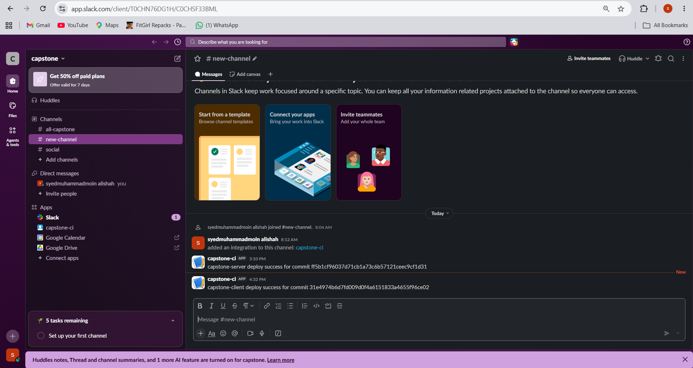

## Terminal output

The log below was collected during the project: the local test, both Terraform runs, the VM checks, the monitoring containers, and the server and client deployments including the checksum result.

```
=== Part 1: client output (local test) ===
capstone-client  | [client] connecting to host.docker.internal:5001
capstone-client  | [client] saved /clientdata/data_20261114_053107.txt (1024 bytes)
capstone-client  | [client] received checksum : 822ec5efd06f7ba97f2e6086367caf301d18ea3bdf90d917babd1db038a2def6
capstone-client  | [client] calculated checksum: 822ec5efd06f7ba97f2e6086367caf301d18ea3bdf90d917babd1db038a2def6
capstone-client  | [client] CHECKSUM OK - file is intact
=== Part 1: docker volumes ===
DRIVER    VOLUME NAME
local     417c84156ef90b0997f29ddbe5401c126e3a0a7a5b8f9ebfe71a9a22faa3dcb5
local     assignment2-part2-compose_db_data
local     assignment2-part2-compose_grafana_data
local     clientvol
local     minikube
local     servervol
=== Part 1: files in servervol ===
total 4
-rw-r--r--    1 root     root          1024 Nov 14 05:31 data_20261114_053107.txt
=== Part 1: files in clientvol ===
total 4
-rw-r--r--    1 root     root          1024 Nov 14 05:31 data_20261114_053107.txt
=== Part 1: checksum in servervol ===
822ec5efd06f7ba97f2e6086367caf301d18ea3bdf90d917babd1db038a2def6  /data/data_20261114_053107.txt
=== Part 1: checksum in clientvol ===
822ec5efd06f7ba97f2e6086367caf301d18ea3bdf90d917babd1db038a2def6  /data/data_20261114_053107.txt
=== Part 2: terraform apply result (server repo) ===
server_private_ip = "10.0.1.145"
server_public_ip = "54.253.153.138"
vpc_id = "vpc-02fbd826aa92b1368"
data.aws_ami.ubuntu
data.aws_availability_zones.available
aws_instance.server
aws_internet_gateway.igw
aws_key_pair.server
aws_route_table.public
aws_route_table_association.client
aws_route_table_association.server
aws_security_group.server
aws_subnet.client
aws_subnet.server
aws_vpc.main
=== Part 2: terraform apply result (client repo) ===
client_private_ip = "10.0.2.115"
client_public_ip = "13.210.193.226"
data.aws_ami.ubuntu
data.aws_subnet.client
data.aws_vpc.main
aws_instance.client
aws_key_pair.client
aws_security_group.client
=== Part 2: client VM check and ping to server VM ===
Docker version 29.1.3, build 29.1.3-0ubuntu3~24.04.2
Docker Compose version 2.40.3+ds1-0ubuntu1~24.04.1
               total        used        free      shared  buff/cache   available
Mem:           909Mi       360Mi        82Mi       2.8Mi       582Mi       548Mi
Swap:          2.0Gi       8.0Ki       2.0Gi
PING 10.0.1.145 (10.0.1.145) 56(84) bytes of data.
64 bytes from 10.0.1.145: icmp_seq=1 ttl=64 time=0.209 ms
64 bytes from 10.0.1.145: icmp_seq=2 ttl=64 time=0.222 ms
64 bytes from 10.0.1.145: icmp_seq=3 ttl=64 time=0.212 ms

--- 10.0.1.145 ping statistics ---
3 packets transmitted, 3 received, 0% packet loss, time 2046ms
rtt min/avg/max/mdev = 0.209/0.214/0.222/0.005 ms
=== Part 2: server VM check ===
Docker version 29.1.3, build 29.1.3-0ubuntu3~24.04.2
Docker Compose version 2.40.3+ds1-0ubuntu1~24.04.1
               total        used        free      shared  buff/cache   available
Mem:           909Mi       368Mi       117Mi       2.7Mi       539Mi       541Mi
Swap:          2.0Gi        24Ki       2.0Gi
--- Server VM: monitoring containers ---
CONTAINER ID   IMAGE                              COMMAND                  CREATED         STATUS                   PORTS                                         NAMES
5eb6f5f4c110   grafana/grafana-oss:latest         "/run.sh"                5 minutes ago   Up 5 minutes             0.0.0.0:3020->3000/tcp, [::]:3020->3000/tcp   grafana
a208f430d24f   prom/prometheus:latest             "/bin/prometheus --c???"   5 minutes ago   Up 5 minutes             9090/tcp                                      prometheus
04ba54e8deec   prom/node-exporter:latest          "/bin/node_exporter ???"   5 minutes ago   Up 5 minutes             9100/tcp                                      node-exporter
843b81225aad   gcr.io/cadvisor/cadvisor:v0.49.1   "/usr/bin/cadvisor -???"   5 minutes ago   Up 5 minutes (healthy)   8080/tcp                                      cadvisor
CONTAINER ID   NAME            CPU %     MEM USAGE / LIMIT     MEM %     NET I/O          BLOCK I/O         PIDS
5eb6f5f4c110   grafana         0.67%     243.8MiB / 909.5MiB   26.81%    223kB / 196kB    342MB / 15.6MB    12
a208f430d24f   prometheus      0.29%     56.89MiB / 909.5MiB   6.26%     472kB / 58.4kB   125MB / 13.9MB    8
04ba54e8deec   node-exporter   0.00%     12.67MiB / 909.5MiB   1.39%     16.1kB / 275kB   25.7MB / 1.13MB   5
843b81225aad   cadvisor        0.03%     29.51MiB / 909.5MiB   3.24%     14.8kB / 138kB   44.6MB / 4.13MB   10
--- Client VM: monitoring containers ---
CONTAINER ID   IMAGE                              COMMAND                  CREATED         STATUS                   PORTS                                         NAMES
3040eaaf16ed   grafana/grafana-oss:latest         "/run.sh"                7 minutes ago   Up 7 minutes             0.0.0.0:3020->3000/tcp, [::]:3020->3000/tcp   grafana
20a4369af155   prom/prometheus:latest             "/bin/prometheus --c???"   7 minutes ago   Up 7 minutes             9090/tcp                                      prometheus
3511d1ea5617   prom/node-exporter:latest          "/bin/node_exporter ???"   7 minutes ago   Up 7 minutes             9100/tcp                                      node-exporter
55d53e7b4cbd   gcr.io/cadvisor/cadvisor:v0.49.1   "/usr/bin/cadvisor -???"   7 minutes ago   Up 7 minutes (healthy)   8080/tcp                                      cadvisor
CONTAINER ID   NAME            CPU %     MEM USAGE / LIMIT     MEM %     NET I/O           BLOCK I/O         PIDS
3040eaaf16ed   grafana         0.66%     163.9MiB / 909.5MiB   18.02%    21.6MB / 64.5kB   260MB / 123MB     17
20a4369af155   prometheus      0.32%     37.48MiB / 909.5MiB   4.12%     498kB / 33.4kB    85.8MB / 5.9MB    8
3511d1ea5617   node-exporter   0.00%     12.84MiB / 909.5MiB   1.41%     19.6kB / 335kB    23.6MB / 348kB    4
55d53e7b4cbd   cadvisor        0.00%     23.52MiB / 909.5MiB   2.59%     17.2kB / 162kB    38.6MB / 2.64MB   10
--- Server VM: server app ---
CONTAINER ID   IMAGE                                 COMMAND                  CREATED         STATUS                 PORTS                                         NAMES
22761c8781a6   syedshah3994/capstone-server:latest   "python -u server.py"    2 minutes ago   Up 2 minutes           0.0.0.0:5000->5000/tcp, [::]:5000->5000/tcp   capstone-server
5eb6f5f4c110   grafana/grafana-oss:latest            "/run.sh"                8 hours ago     Up 8 hours             0.0.0.0:3020->3000/tcp, [::]:3020->3000/tcp   grafana
a208f430d24f   prom/prometheus:latest                "/bin/prometheus --c???"   8 hours ago     Up 8 hours             9090/tcp                                      prometheus
04ba54e8deec   prom/node-exporter:latest             "/bin/node_exporter ???"   8 hours ago     Up 8 hours             9100/tcp                                      node-exporter
843b81225aad   gcr.io/cadvisor/cadvisor:v0.49.1      "/usr/bin/cadvisor -???"   8 hours ago     Up 8 hours (healthy)   8080/tcp                                      cadvisor
--- Client VM: end-to-end test ---
time="2026-11-15T02:43:51Z" level=warning msg="Docker Compose is configured to build using Bake, but buildx isn't installed"
#0 building with "default" instance using docker driver

#1 [client internal] load build definition from Dockerfile
#1 transferring dockerfile:
#1 transferring dockerfile: 350B 0.0s done
#1 DONE 0.1s

#2 [client internal] load metadata for docker.io/library/python:3.12-slim
#2 DONE 2.3s

#3 [client internal] load .dockerignore
#3 transferring context: 117B done
#3 DONE 0.0s

#4 [client internal] load build context
#4 DONE 0.0s

#5 [client 1/7] FROM docker.io/library/python:3.12-slim@sha256:5e2bdb1b0d542d5039cffb8181c65930093949194a65c365dfb1b0fe13a4fa5b
#5 resolve docker.io/library/python:3.12-slim@sha256:5e2bdb1b0d542d5039cffb8181c65930093949194a65c365dfb1b0fe13a4fa5b 0.0s done
#5 DONE 0.0s

#4 [client internal] load build context
#4 transferring context: 2.17kB done
#4 DONE 0.1s

#5 [client 1/7] FROM docker.io/library/python:3.12-slim@sha256:5e2bdb1b0d542d5039cffb8181c65930093949194a65c365dfb1b0fe13a4fa5b
#5 DONE 0.2s

#5 [client 1/7] FROM docker.io/library/python:3.12-slim@sha256:5e2bdb1b0d542d5039cffb8181c65930093949194a65c365dfb1b0fe13a4fa5b
#5 sha256:05e0eee5572e9c9f50408a2132590133b830a668a1cf2ff2b150f19c57707e2b 0B / 248B 0.2s
#5 sha256:05e0eee5572e9c9f50408a2132590133b830a668a1cf2ff2b150f19c57707e2b 248B / 248B 0.2s done
#5 sha256:2dc99d2d0a39fce31e37615eb4c932e16dcc4c2b0ce9993714280081b5dbe085 0B / 12.12MB 0.3s
#5 sha256:68bced9e0afa4479df17c3646e27c7c7e9ce9ba70c0e6c73b6826487b89037d9 0B / 1.29MB 0.2s
#5 sha256:37fb86c2a767b88d500c6872195f88078f64765fe0d2f9cc375cc2efbd4c0a41 0B / 29.86MB 0.2s
#5 sha256:2dc99d2d0a39fce31e37615eb4c932e16dcc4c2b0ce9993714280081b5dbe085 1.05MB / 12.12MB 0.5s
#5 sha256:2dc99d2d0a39fce31e37615eb4c932e16dcc4c2b0ce9993714280081b5dbe085 12.12MB / 12.12MB 0.6s done
#5 sha256:68bced9e0afa4479df17c3646e27c7c7e9ce9ba70c0e6c73b6826487b89037d9 1.29MB / 1.29MB 0.6s done
#5 sha256:37fb86c2a767b88d500c6872195f88078f64765fe0d2f9cc375cc2efbd4c0a41 6.29MB / 29.86MB 0.8s
#5 sha256:37fb86c2a767b88d500c6872195f88078f64765fe0d2f9cc375cc2efbd4c0a41 23.07MB / 29.86MB 0.9s
#5 sha256:37fb86c2a767b88d500c6872195f88078f64765fe0d2f9cc375cc2efbd4c0a41 29.86MB / 29.86MB 1.0s done
#5 extracting sha256:37fb86c2a767b88d500c6872195f88078f64765fe0d2f9cc375cc2efbd4c0a41
#5 extracting sha256:37fb86c2a767b88d500c6872195f88078f64765fe0d2f9cc375cc2efbd4c0a41 1.2s done
#5 DONE 2.4s

#5 [client 1/7] FROM docker.io/library/python:3.12-slim@sha256:5e2bdb1b0d542d5039cffb8181c65930093949194a65c365dfb1b0fe13a4fa5b
#5 extracting sha256:68bced9e0afa4479df17c3646e27c7c7e9ce9ba70c0e6c73b6826487b89037d9 0.1s done
#5 DONE 2.6s

#5 [client 1/7] FROM docker.io/library/python:3.12-slim@sha256:5e2bdb1b0d542d5039cffb8181c65930093949194a65c365dfb1b0fe13a4fa5b
#5 extracting sha256:2dc99d2d0a39fce31e37615eb4c932e16dcc4c2b0ce9993714280081b5dbe085
#5 extracting sha256:2dc99d2d0a39fce31e37615eb4c932e16dcc4c2b0ce9993714280081b5dbe085 0.6s done
#5 DONE 3.1s

#5 [client 1/7] FROM docker.io/library/python:3.12-slim@sha256:5e2bdb1b0d542d5039cffb8181c65930093949194a65c365dfb1b0fe13a4fa5b
#5 extracting sha256:05e0eee5572e9c9f50408a2132590133b830a668a1cf2ff2b150f19c57707e2b 0.0s done
#5 DONE 3.2s

#6 [client 2/7] RUN apt-get update && apt-get install -y --no-install-recommends netcat-openbsd && rm -rf /var/lib/apt/lists/*
#6 0.874 Hit:1 http://deb.debian.org/debian trixie InRelease
#6 0.875 Get:2 http://deb.debian.org/debian trixie-updates InRelease [47.3 kB]
#6 0.886 Get:3 http://deb.debian.org/debian-security trixie-security InRelease [43.4 kB]
#6 0.943 Get:4 http://deb.debian.org/debian trixie/main amd64 Packages [9678 kB]
#6 1.075 Get:5 http://deb.debian.org/debian trixie-updates/main amd64 Packages [1108 B]
#6 1.076 Get:6 http://deb.debian.org/debian-security trixie-security/main amd64 Packages [304 kB]
#6 2.201 Fetched 10.1 MB in 1s (7335 kB/s)
#6 2.201 Reading package lists...
#6 2.983 Reading package lists...
#6 3.821 Building dependency tree...
#6 4.053 Reading state information...
#6 4.437 The following NEW packages will be installed:
#6 4.438   netcat-openbsd
#6 4.480 0 upgraded, 1 newly installed, 0 to remove and 1 not upgraded.
#6 4.480 Need to get 42.5 kB of archives.
#6 4.480 After this operation, 112 kB of additional disk space will be used.
#6 4.480 Get:1 http://deb.debian.org/debian trixie/main amd64 netcat-openbsd amd64 1.229-1 [42.5 kB]
#6 4.763 debconf: unable to initialize frontend: Dialog
#6 4.763 debconf: (TERM is not set, so the dialog frontend is not usable.)
#6 4.763 debconf: falling back to frontend: Readline
#6 4.764 debconf: unable to initialize frontend: Readline
#6 4.764 debconf: (Can't locate Term/ReadLine.pm in @INC (you may need to install the Term::ReadLine module) (@INC entries checked: /etc/perl /usr/local/lib/x86_64-linux-gnu/perl/5.40.1 /usr/local/share/perl/5.40.1 /usr/lib/x86_64-linux-gnu/perl5/5.40 /usr/share/perl5 /usr/lib/x86_64-linux-gnu/perl-base /usr/lib/x86_64-linux-gnu/perl/5.40 /usr/share/perl/5.40 /usr/local/lib/site_perl) at /usr/share/perl5/Debconf/FrontEnd/Readline.pm line 8, <STDIN> line 1.)
#6 4.764 debconf: falling back to frontend: Teletype
#6 4.771 debconf: unable to initialize frontend: Teletype
#6 4.771 debconf: (This frontend requires a controlling tty.)
#6 4.771 debconf: falling back to frontend: Noninteractive
#6 5.586 Fetched 42.5 kB in 0s (2423 kB/s)
#6 5.629 Selecting previously unselected package netcat-openbsd.
#6 5.629 (Reading database ... 
(Reading database ... 5%
(Reading database ... 10%
(Reading database ... 15%
(Reading database ... 20%
(Reading database ... 25%
(Reading database ... 30%
(Reading database ... 35%
(Reading database ... 40%
(Reading database ... 45%
(Reading database ... 50%
(Reading database ... 55%
(Reading database ... 60%
(Reading database ... 65%
(Reading database ... 70%
(Reading database ... 75%
(Reading database ... 80%
(Reading database ... 85%
(Reading database ... 90%
(Reading database ... 95%
(Reading database ... 100%
(Reading database ... 5658 files and directories currently installed.)
#6 5.683 Preparing to unpack .../netcat-openbsd_1.229-1_amd64.deb ...
#6 5.688 Unpacking netcat-openbsd (1.229-1) ...
#6 5.736 Setting up netcat-openbsd (1.229-1) ...
#6 5.757 update-alternatives: using /bin/nc.openbsd to provide /bin/nc (nc) in auto mode
#6 5.759 update-alternatives: warning: skip creation of /usr/share/man/man1/nc.1.gz because associated file /usr/share/man/man1/nc_openbsd.1.gz (of link group nc) doesn't exist
#6 5.759 update-alternatives: warning: skip creation of /usr/share/man/man1/netcat.1.gz because associated file /usr/share/man/man1/nc_openbsd.1.gz (of link group nc) doesn't exist
#6 DONE 5.9s

#7 [client 3/7] WORKDIR /app
#7 DONE 0.1s

#8 [client 4/7] COPY requirements.txt .
#8 DONE 0.1s

#9 [client 5/7] RUN pip install --no-cache-dir -r requirements.txt
#9 2.490 WARNING: Running pip as the 'root' user can result in broken permissions and conflicting behaviour with the system package manager, possibly rendering your system unusable. It is recommended to use a virtual environment instead: https://pip.pypa.io/warnings/venv. Use the --root-user-action option if you know what you are doing and want to suppress this warning.
#9 2.572 
#9 2.572 [notice] A new release of pip is available: 25.0.1 -> 26.3
#9 2.572 [notice] To update, run: pip install --upgrade pip
#9 DONE 2.7s

#10 [client 6/7] COPY app/ .
#10 DONE 0.1s

#11 [client 7/7] RUN mkdir -p /clientdata
#11 DONE 0.2s

#12 [client] exporting to image
#12 exporting layers
#12 exporting layers 0.8s done
#12 exporting manifest sha256:4356b18a3901d075177c9c1083cc72e88a85d37ea32bee1f4629da5f129c0440 0.0s done
#12 exporting config sha256:123597dbf55179fadcf78d57676c7a0f899fe83001530a63bb83944759fbf2e7 0.0s done
#12 exporting attestation manifest sha256:7a9c01f5b13701cc55213f2d2e941150689aaccc97dcfc7910b8c06a82e4d4fe 0.0s done
#12 exporting manifest list sha256:fcc330abae91f692045e2f32b622fdfb3004ed9fae5122a9d13972e75b5e8ec5
#12 exporting manifest list sha256:fcc330abae91f692045e2f32b622fdfb3004ed9fae5122a9d13972e75b5e8ec5 0.0s done
#12 naming to docker.io/syedshah3994/capstone-client:latest 0.0s done
#12 unpacking to docker.io/syedshah3994/capstone-client:latest
#12 unpacking to docker.io/syedshah3994/capstone-client:latest 0.3s done
#12 DONE 1.3s

#13 [client] resolving provenance for metadata file
#13 DONE 0.0s
 client  Built
 Network capstone-client_default  Creating
 Network capstone-client_default  Created
 Volume clientvol  Creating
 Volume clientvol  Created
 Container capstone-client  Creating
 Container capstone-client  Created
Attaching to capstone-client
capstone-client  | [client] connecting to 10.0.1.145:5000
capstone-client  | [client] saved /clientdata/data_20261115_024409.txt (1024 bytes)
capstone-client  | [client] received checksum : c8c41713e56bc41d37130b4e03ff53e321e2b019a09e2af1794a20bbd666311c
capstone-client  | [client] calculated checksum: c8c41713e56bc41d37130b4e03ff53e321e2b019a09e2af1794a20bbd666311c
capstone-client  | [client] CHECKSUM OK - file is intact

capstone-client exited with code 0
Aborting on container exit...
 Container capstone-client  Stopping
 Container capstone-client  Stopped
 Container capstone-client  Stopping
 Container capstone-client  Stopped
 Container capstone-client  Removing
 Container capstone-client  Removed
 Network capstone-client_default  Removing
 Network capstone-client_default  Removed

=== Server pipeline: docker ps and compose image line ===
CONTAINER ID   IMAGE                                                                   COMMAND                  CREATED         STATUS                  PORTS                                         NAMES
d39898cf5c02   syedshah3994/capstone-server:ff5b1cf96037d71cb1a73c6b57121ceec9cf1d31   "python -u server.py"    3 minutes ago   Up 3 minutes            0.0.0.0:5000->5000/tcp, [::]:5000->5000/tcp   capstone-server
5eb6f5f4c110   grafana/grafana-oss:latest                                              "/run.sh"                16 hours ago    Up 16 hours             0.0.0.0:3020->3000/tcp, [::]:3020->3000/tcp   grafana
a208f430d24f   prom/prometheus:latest                                                  "/bin/prometheus --c???"   16 hours ago    Up 16 hours             9090/tcp                                      prometheus
04ba54e8deec   prom/node-exporter:latest                                               "/bin/node_exporter ???"   16 hours ago    Up 16 hours             9100/tcp                                      node-exporter
843b81225aad   gcr.io/cadvisor/cadvisor:v0.49.1                                        "/usr/bin/cadvisor -???"   16 hours ago    Up 16 hours (healthy)   8080/tcp                                      cadvisor
    image: syedshah3994/capstone-server:latest

=== Client pipeline: docker ps and compose image line ===
CONTAINER ID   IMAGE                                                                   COMMAND                  CREATED        STATUS                   PORTS                                         NAMES
1b2a2b177e86   syedshah3994/capstone-client:31e4974b6d7fd009d0f4a6151833a4655f96ce02   "python -u client.py"    8 hours ago    Exited (0) 8 hours ago                                                 capstone-client
3040eaaf16ed   grafana/grafana-oss:latest                                              "/run.sh"                17 hours ago   Up 17 hours              0.0.0.0:3020->3000/tcp, [::]:3020->3000/tcp   grafana
20a4369af155   prom/prometheus:latest                                                  "/bin/prometheus --c???"   17 hours ago   Up 17 hours              9090/tcp                                      prometheus
3511d1ea5617   prom/node-exporter:latest                                               "/bin/node_exporter ???"   17 hours ago   Up 17 hours              9100/tcp                                      node-exporter
55d53e7b4cbd   gcr.io/cadvisor/cadvisor:v0.49.1                                        "/usr/bin/cadvisor -???"   17 hours ago   Up 17 hours (healthy)    8080/tcp                                      cadvisor
    image: syedshah3994/capstone-client:31e4974b6d7fd009d0f4a6151833a4655f96ce02

=== Client pipeline: container log ===
[client] connecting to 10.0.1.145:5000
[client] saved /clientdata/data_20261115_113230.txt (1024 bytes)
[client] received checksum : 5d842b3915dc0062865499ae26c13f33e1f0a601b36770565c272afc5d7f81dc
[client] calculated checksum: 5d842b3915dc0062865499ae26c13f33e1f0a601b36770565c272afc5d7f81dc
[client] CHECKSUM OK - file is intact
```

## Troubleshooting

- cAdvisor and Docker 29: Docker 29 uses the containerd image store, which cAdvisor v0.49.1 cannot read, so per-container labels are missing and the Docker dashboard (ID 14282) shows no data. The host dashboard (ID 1860) works. Use `docker ps` and `docker stats` for per-container information.
- Port 5000 blocked on Windows: run the server with `HOST_PORT=5001` and set `SERVER_PORT=5001` for the client.
- The client cannot connect: check that `SERVER_HOST` is the private address of the server VM, that the server container is running, and that the security group allows port 5000 from inside the VPC.
- SSH drops with `client_loop: send disconnect`: reconnect with `ssh -o ServerAliveInterval=30 -i <key> ubuntu@<public IP>`.
- SSH refused after your IP changed: update the allowed IP in `terraform.tfvars` and run `terraform apply` again.
- `Invalid workflow file` with a YAML syntax error: put commands that contain `image: ` in a `run: |` block.
- A Node.js 20 deprecation warning and a Compose buildx warning appear in the logs. Both are harmless.
- Security: the repository is public, so the workflow only runs on `push`, not on pull requests from forks, and the self-hosted runner should not be used for untrusted code.
